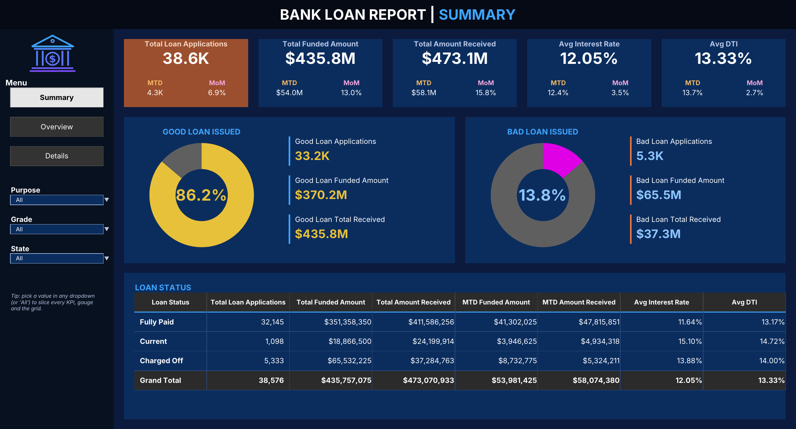
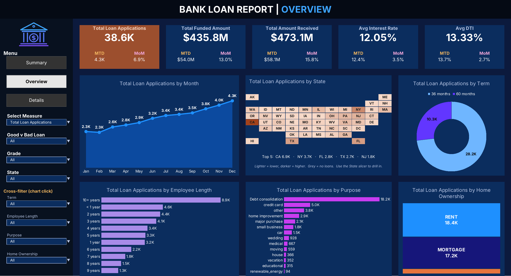
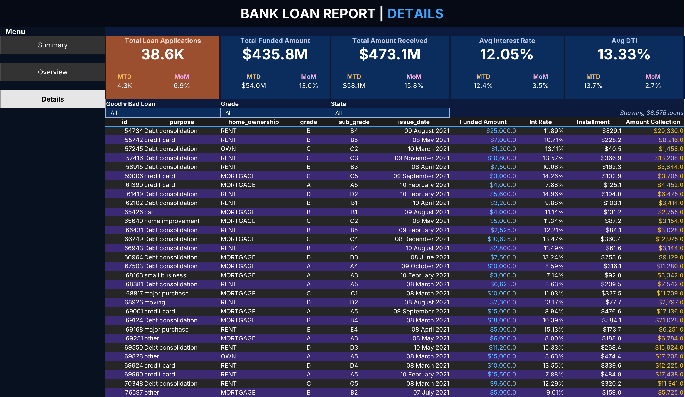

# Bank Loan Report – Excel Dashboard

An Excel version of the Power BI **Bank Loan Analysis** project
([video](https://youtu.be/3I8wd1AShXs)), built on the project dataset
`data/financial_loan.csv` (38,576 loans, Jan–Dec 2021).

## Screenshots

### Summary


### Overview


### Details


## Getting started

**Open `Bank_Loan_Dashboard.xlsx`** in Excel 2021 or Microsoft 365. It needs no macros, add-ins or data connections.

| Sheet | What's on it |
|---|---|
| **Summary** | 5 KPI cards (Total Loan Applications, Total Funded Amount, Total Amount Received, Avg Interest Rate, Avg DTI), each with **MTD** and **MoM %**. Good Loan vs Bad Loan gauges with applications / funded / received. **Loan Status** grid (applications, funded, received, MTD funded, MTD received, avg rate, avg DTI + Grand Total). Slicers: Purpose, Grade, State. |
| **Overview** | Same KPI cards plus 6 charts: Monthly Trend by Issue Date (area + line), Regional Analysis by State (US tile map coloured as a heat map), Loan Term (donut), Employee Length (bars), Loan Purpose (bars), Home Ownership (treemap-style blocks). Slicers: **Select Measure** (field parameter), Good v Bad Loan, Grade, State, plus cross-filter dropdowns for Term, Employee Length, Purpose and Home Ownership. |
| **Details** | KPI cards + the full loan grid (id, purpose, home ownership, grade, sub grade, issue date, funded amount, interest rate, installment, amount collected). Slicers: Good v Bad Loan, Grade, State. The header stays fixed while the grid scrolls. |
| Guide | How each Power BI feature was rebuilt in Excel. |
| Data | The dataset as the Excel table `tblLoan`, plus helper columns (`good_vs_bad`, `issue_month`, `year_month`). |
| Calc | The calculation engine. Every number on the dashboards is calculated here and can be read top to bottom. |

## How the Power BI features map to Excel

| Power BI (video) | Excel |
|---|---|
| Page navigator buttons | Hyperlink buttons on every page; the current page's button is highlighted |
| Dropdown slicers | Data-validation dropdowns; `All` = no filter. All KPIs use `COUNTIFS` / `SUMIFS` / `AVERAGEIFS` |
| Field parameter "Select Measure" | Dropdown that switches every Overview chart, its data labels **and its title** between the 3 measures |
| Edit interactions (click a visual to filter the others) | "Cross-filter" dropdowns filter the KPIs and all other charts; the chart for that dimension still shows every category, as in Power BI |
| Good vs Bad group | Fully Paid + Current = Good Loan, Charged Off = Bad Loan |
| `TOTALMTD` / `DATEADD` measures | MTD = latest issue month (Dec 2021), PMTD = previous month, MoM = (MTD − PMTD) / PMTD |
| Filled map | US tile map coloured with a 2-colour scale, plus a "Top 5 states" line |
| Treemap | 100 % stacked block, sorted largest-first |
| Bars sorted by value | Ranked with `LARGE`/`INDEX`/`MATCH`, so the order stays correct under any filter |
| Table visual | One `FILTER()` spill formula |

## Validation

The workbook's numbers match the Power BI report and the SQL "Query Doc" results:
38.6K applications · $435.8M funded · $473.1M received · 12.05 % avg rate ·
13.33 % avg DTI · MTD 4.3K / MoM 6.9 %. Good loans: 86.2 %, 33.2K, $370.2M, $435.8M. Bad loans: 13.8 %, 5.3K, $65.5M, $37.3M.
The Loan Status grid matches line for line.
Filtered results (for example Purpose = credit card, Grade = B, or the Overview measure switched to
Funded Amount with cross-filters) were checked cell by cell against an
independent pandas calculation.

## Rebuilding

```bash
pip install pandas xlsxwriter openpyxl pillow
python build_dashboard.py
```

If LibreOffice is installed, the build calculates the workbook once and stores the results in the
file. KPIs, chart labels and titles then show correct values even in Excel's Protected View,
before you click "Enable Editing". Without LibreOffice, Excel calculates everything when the file opens.

To regenerate the screenshots (needs LibreOffice and poppler's `pdftoppm`):

```bash
python make_screenshots.py   # writes docs/screenshots/*.png
```

**Note:** the Details grid uses `FILTER`, so it needs Excel 2021 or Microsoft 365. The rest of the workbook
works in Excel 2010 and later.
